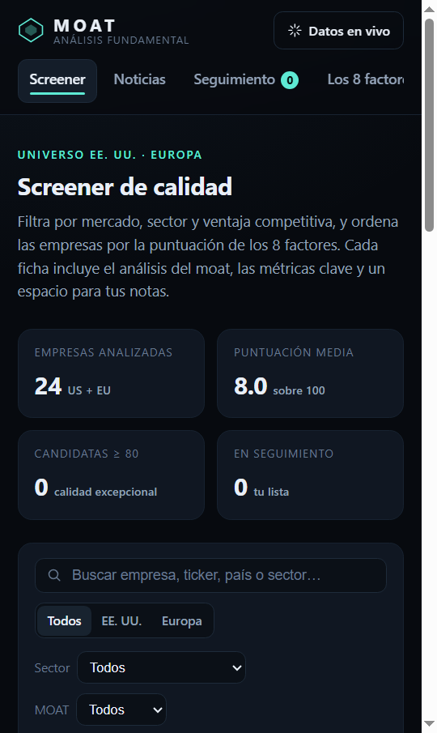
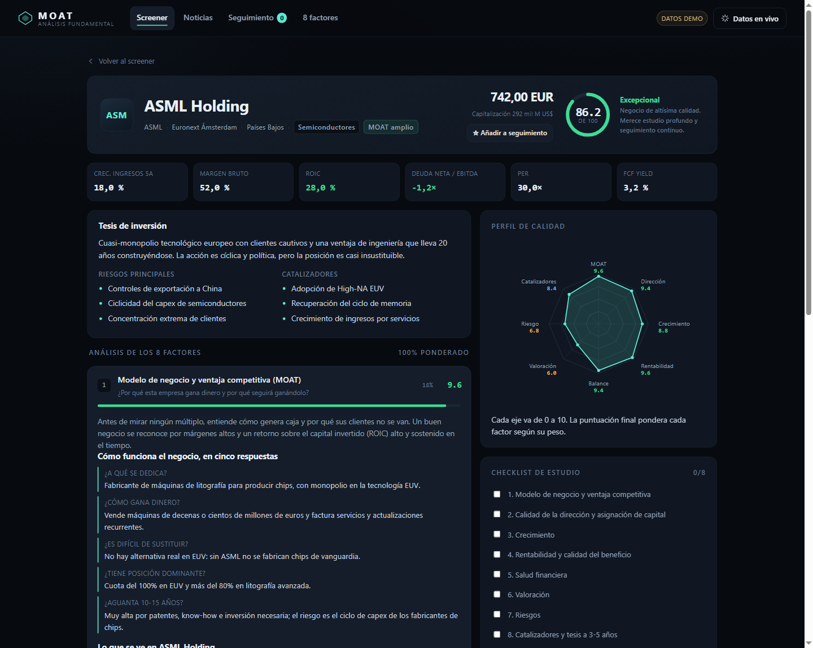
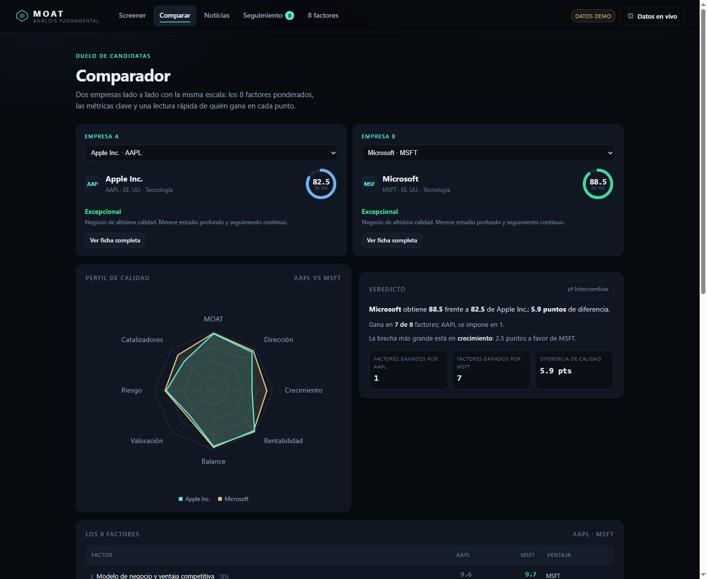
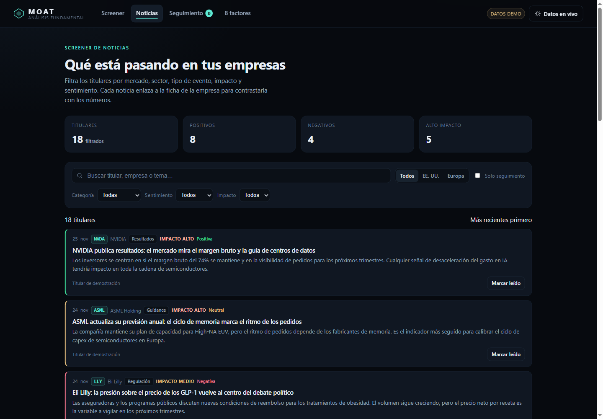
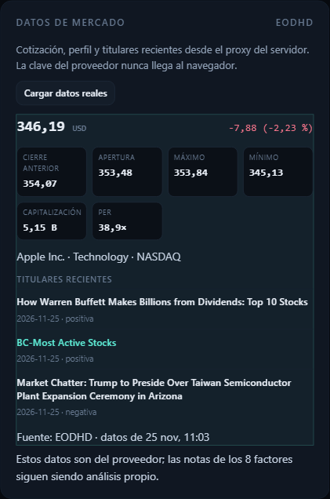
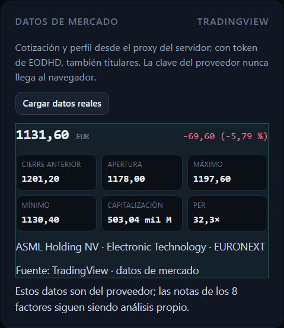
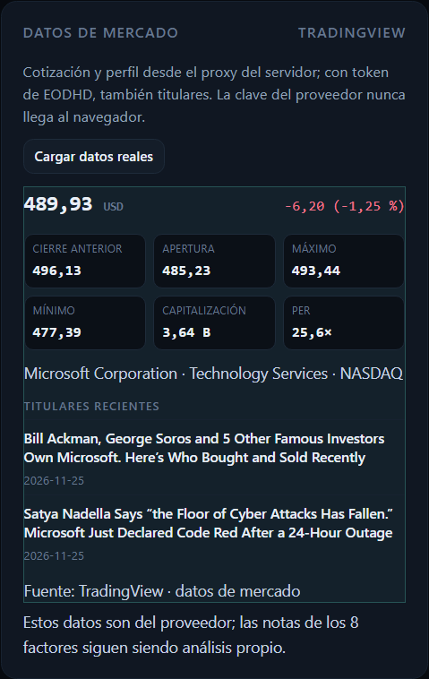
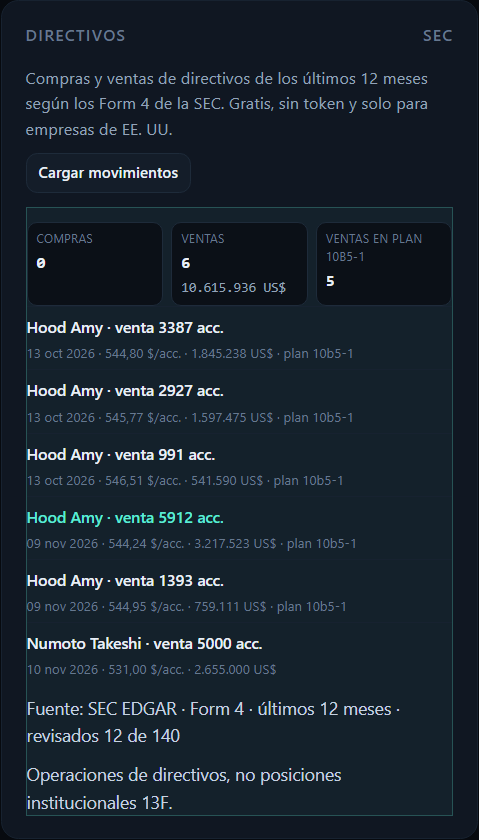

# App-screener

Screener para buscar y estudiar acciones de **EE. UU. y Europa** con un marco de análisis fundamental de **8 factores** (MOAT, dirección, crecimiento, rentabilidad, balance, valoración, riesgos y catalizadores), más un screener de noticias.

## Qué incluye la app

- **Buscador de cualquier valor**: el buscador de la cabecera consulta el catálogo de símbolos de EODHD (más de 60 bolsas) y abre una ficha con datos reales para cualquier empresa o ETF de EE. UU. o Europa, no solo las 24 cargadas.
- **Screener de calidad**: 24 empresas (12 estadounidenses y 12 europeas) filtrables por mercado, sector y tipo de moat, ordenables por puntuación, crecimiento, ROIC, PER o capitalización.
- **Ficha de empresa**: tesis, riesgos y catalizadores, las cinco preguntas del MOAT respondidas, los 8 factores con su peso y puntuación, métricas clave, checklist de estudio y notas del analista (guardadas en el dispositivo).
- **Notas automáticas y notas propias**: cada factor muestra si su nota es automática (calculada con las cuentas reales de EODHD), de demostración, neutral por falta de datos o puesta por ti; al abrir un factor se ve la rúbrica completa (indicador, valor, banda y puntos) y puedes sobrescribir la nota con tu criterio y un motivo.
- **Comparador**: dos empresas lado a lado con radar superpuesto, los 8 factores (con la ganadora de cada uno) y una tabla de métricas clave que marca el mejor valor de cada fila.
- **Screener de noticias**: titulares filtrables por mercado, categoría, sentimiento e impacto, con enlaces a la ficha de cada empresa.
- **Seguimiento**: lista propia de empresas con el avance del análisis y copia de seguridad en JSON de todo tu trabajo.
- **Guía de los 8 factores**: preguntas, métricas y señales verdes/rojas de cada factor, escala de puntuación y proceso en 6 pasos.

> Los datos de perfil de las 24 empresas incluidas son de **demostración**. Las notas de los 8 factores pueden recalcularse con las cuentas reales de EODHD (ver *Notas automáticas*), pero la cotización, el perfil y las noticias reales también se piden a EODHD a través del proxy del servidor. Verifica siempre los datos con las cuentas oficiales antes de invertir.

## Capturas

Vistas de la app real, tomadas del build local. Los datos de las 24 empresas son de demostración; la tarjeta de mercado muestra la respuesta real de EODHD.

**Screener de calidad** — filtros por mercado, sector y moat, y ranking por los 8 factores.



**Ficha de empresa** — tesis, riesgos, catalizadores, radar de calidad y rúbrica del factor abierto.



**Comparador** — dos empresas lado a lado, radar superpuesto, veredicto y ganadora de cada factor.



**Screener de noticias** — titulares filtrables por mercado, categoría, sentimiento e impacto.



**Datos de mercado** — cotización, perfil y titulares reales pedidos al proxy del servidor.



**Datos gratis, sin token** — la fuente gratuita cubre también las bolsas europeas, con la moneda local.



**Titulares sin token** — noticias del valor desde el RSS gratuito, filtradas por relevancia.



**Directivos** — compras y ventas de los Form 4 de la SEC, con el resumen del periodo y el plan 10b5-1.



Recortes: [perfil de calidad](artifacts/radar.png) · [tabla del screener](artifacts/screener-tabla.png) · [cabecera del comparador](artifacts/comparador-cabecera.png) · [tablas del comparador](artifacts/comparador-tablas.png) · [ficha en móvil](artifacts/ficha-msft.png).

## Buscar cualquier valor

La cabecera tiene un buscador que consulta `GET /api/search`, y el proxy lo resuelve con la **fuente gratuita** (TradingView) o con el **buscador de EODHD** si hay token. El navegador nunca habla con el proveedor: solo con `/api/search`.

- **Filtro geográfico**: se queda con NYSE/NASDAQ y las bolsas europeas (LSE, Euronext, Xetra, SIX, BME, Borsa Italiana, Nasdaq Nordic, Oslo, Viena, Varsovia…). Los valores de otros mercados no aparecen.
- **Filtro de instrumentos**: fuera warrants, bonos, notas, derechos, índices, futuros y fondos de inversión; quedan acciones y ETFs.
- **Orden**: primero la coincidencia exacta de ticker, después las acciones comunes y al final por nombre. Se eliminan duplicados por `TICKER.BOLSA`.
- **Validación**: la consulta debe tener entre 2 y 40 caracteres y solo admite letras, números y `. , & ( ) + -`. Cualquier otra cosa devuelve `invalid_query` (400).
- **Caché** de 24 h por consulta para no gastar cuota; el límite de 120 peticiones/minuto por IP sigue aplicando.

Al elegir un resultado se abre `#/empresa/ASML.AS`. Si el ticker no está entre las 24 empresas de demostración, la ficha se construye con datos reales:

- `/api/fundamentals` aporta nombre, sector, industria, descripción, bolsa, moneda, capitalización y PER.
- `/api/quote` aporta la cotización.
- `/api/analysis` calcula las notas de los 8 factores con las cuentas reales y su rúbrica, que se muestra factor a factor igual que en las fichas del universo.
- Se puede sobrescribir cualquier nota, seguir el valor y escribir notas del analista; el perfil queda guardado en el dispositivo para la próxima visita.

Como esas empresas no tienen análisis editorial, la ficha muestra **Perfil de la empresa** en lugar de la tesis, los riesgos y los catalizadores de las 24 de demostración.

> **Sin token**: el buscador, la cotización, los fundamentales básicos y los titulares salen de fuentes gratuitas, que cubren EE. UU. y las principales bolsas europeas. Solo `/api/analysis` (notas con las cuentas reales) necesita `EODHD_API_TOKEN`.

## Notas automáticas: la rúbrica

`server/rubric.mjs` calcula la nota de cada factor a partir de los estados financieros que devuelve EODHD (income statement, balance y cash flow anuales). Nada se estima: si un indicador no está en las cuentas, queda como `null` y no suma.

Cada factor se compone de indicadores con peso propio, y cada indicador se puntúa por **bandas explícitas** (0-10). Ejemplo del factor MOAT:

| Indicador | Peso | Bandas |
|---|---|---|
| ROIC medio de 6 ejercicios | 50 % | < 8 % → 2 · 8-12 % → 4 · 12-15 % → 5,5 · 15-20 % → 7,5 · ≥ 20 % → 10 |
| Años con ROIC ≥ 10 % | 30 % | < 40 % de los años → 2 · 40-60 % → 5 · 60-80 % → 6,5 · 80-90 % → 8 · todos → 10 |
| Margen bruto actual | 20 % | < 20 % → 2,5 · 20-30 % → 4 · 30-45 % → 6 · 45-60 % → 9 · ≥ 60 % → 10 |

La respuesta de `/api/analysis` incluye, por factor, la nota, la confianza (`alta`/`media`/`nula`), la lista de indicadores con su valor, banda y puntos, el método y las notas de cálculo. Incluye además `rubricVersion` (por ejemplo `1.0.0`): la versión de las bandas con la que se calculó la nota. Al cambiar umbrales, pesos o cálculos hay que subirla, de modo que una nota guardada se pueda auditar con las reglas que la produjeron y no con las de hoy. La app pinta esa tabla dentro de cada factor, de modo que cualquier nota puede auditarse número a número.

- **Dirección** usa acciones en circulación, años con flujo de caja libre positivo y payout del dividendo.
- **Crecimiento** usa CAGR de ingresos, años con ingresos crecientes y evolución del margen bruto.
- **Rentabilidad** usa ROIC actual, margen operativo y conversión de caja (FCF / beneficio).
- **Balance** usa deuda neta / EBITDA y cobertura de intereses.
- **Valoración** usa PER, FCF yield, EV / EBITDA y PEG.
- **Riesgos** usa apalancamiento, estabilidad del margen neto y ciclicidad del sector.
- **Catalizadores** no se puede derivar de las cuentas: devuelve 5 neutral con `available: false` y la app lo marca como *neutral*, nunca como automático.

### Automática o tuya

En la cabecera de cada factor aparece el origen de la nota: **automática**, **tu nota**, **neutral** (sin datos) o **demostración** (sin análisis todavía). Al pie de cada factor puedes:

- escribir una nota de 0 a 10 y un motivo, y pulsar **Guardar**: esa nota prevalece sobre la automática y el total, el radar y el screener se recalculan con ella;
- pulsar **Quitar** para volver a la nota automática. La rúbrica sigue visible como evidencia, junto a la comparación «Automática 9,8 · tu nota 3,0».

Las notas propias y los análisis se guardan en `localStorage` de este dispositivo, con una **copia de seguridad** en **Seguimiento → Copia de seguridad**: un JSON con las notas, las sobrescrituras, los perfiles remotos, los checklists, los análisis automáticos, las noticias leídas y el seguimiento. Lleva `version` y `exportedAt`, y al importarlo se sustituyen solo las secciones que incluya el archivo, avisando de lo aplicado; un archivo inválido o de una versión más nueva se rechaza sin tocar los datos.

Además de descargar el JSON, puedes **guardar la copia en el servidor** con un código de 8 caracteres (por ejemplo `ABCD-EFGH`): el proxy la deja en `.data/backups/` (carpeta configurable con `MOAT_DATA_DIR`) y en otro dispositivo basta escribir el código y pulsar *Recuperar*. Cualquiera que tenga el código puede leerla, así que trátalo como una contraseña; el servidor rechaza copias de más de 1 MB, con secciones mal formadas o de una versión más nueva. El análisis con cuentas reales necesita `EODHD_API_TOKEN`; sin token, la app sigue funcionando con la cotización y los fundamentales básicos gratuitos.

## Datos de mercado: fuentes y cómo se conecta

Por defecto la app usa una **fuente gratuita sin clave** (los endpoints públicos del escáner y del buscador de TradingView): cotización, apertura, máximo, mínimo, capitalización, PER, sector y buscador para **todos los símbolos de EE. UU. y de las principales bolsas europeas** (`ASML.AS`, `SAP.DE`, `NESN.SW`, `MC.PA`, `IBE.MC`, `NOVO-B.CO`…). La cotización se pide en cadena y se devuelve la primera que responda, con su nombre en `source`: **TradingView** → **Nasdaq** (`api.nasdaq.com`, solo EE. UU.) → **Yahoo Finance** (`chart` v8, cubre también Europa). Así la tarjeta sigue dando precio si una fuente bloquea o cambia; Yahoo puede devolver 429 si se le insiste desde una misma IP (lo he visto en esta máquina y desaparece solo), así que va el último. No son APIs con contrato estable: si fallan las tres, el proxy devuelve un error claro (`market_unavailable`) con el código de cada intento, nunca datos inventados. **MSN Dinero se descartó**: sus endpoints exigen la clave interna de la app de MSN y responden 401 sin ella.

**Canario diario.** `npm run canary` consulta las tres fuentes en vivo y valida que sigan devolviendo la forma que consume la tarjeta: precio y cierre positivos, cambio coherente con ambos, unidades sin disparates y precios que coinciden entre fuentes (≤ 3 %). Si alguna cambia de formato, el proceso sale con código 1 y el workflow `Canario de fuentes` se pone en rojo. No forma parte de `npm test`, que sigue sin red: corre cada día a las 06:17 UTC y se puede lanzar a mano desde Actions. Un 429 persistente solo avisa, porque es un límite pasajero y no un cambio de formato.

Con `EODHD_API_TOKEN` en `.env` el proxy pasa a **EODHD** (`MARKET_SOURCE=auto` usa EODHD solo si hay token; `free` fuerza la fuente gratuita y `eodhd` la exige). EODHD añade lo que la fuente gratuita no da: estados financieros para el análisis de los 8 factores, titulares y fundamentales completos. Alternativas descartadas para esa parte: FMP limita el plan gratuito a EE. UU.; Finnhub solo da fundamentales de EE. UU. salvo en su plan global; Twelve Data no ofrece noticias y sus fundamentales empiezan en el plan Grow.

La clave **nunca se envía al navegador**. `server/index.js` sirve la web y expone un proxy:

| Endpoint | Devuelve | Caché |
|---|---|---|
| `GET /api/health` | estado del servidor, proveedor activo (TradingView gratis o EODHD) y respaldos de cotización (Nasdaq, Yahoo) | — |
| `GET /api/search?q=asml&limit=15` | valores de EE. UU. y Europa que coinciden con nombre o ticker | 24 h |
| `GET /api/quote?symbol=AAPL` | cotización normalizada | 60 s |
| `GET /api/fundamentals?symbol=ASML.AS` | perfil, sector, capitalización, PER, ROE… | 24 h |
| `GET /api/news?symbol=MSFT&limit=10` | titulares con enlace y sentimiento (RSS de Yahoo y Google sin token; EODHD con token) | 10 min |
| `GET /api/analysis?symbol=AAPL.US` | nota y rúbrica de los 8 factores con las cuentas reales | 24 h |
| `GET /api/insiders?symbol=AAPL.US&months=12&limit=12` | compras y ventas de directivos según los Form 4 de la SEC (sin token) | 1 h |
| `POST /api/backup` | guarda una copia del trabajo y devuelve un código corto (o actualiza la del código indicado) | — |
| `GET /api/backup?code=ABCD-EFGH` | devuelve la copia guardada con ese código | — |

### Movimientos de directivos (SEC, gratis)

`/api/insiders` lee los **Form 4 de SEC EDGAR** y devuelve solo compras y ventas de acciones ordinarias (códigos P y S): fecha, directivo, acciones, precio, importe, si la venta estaba acogida a un plan 10b5-1 y enlace al formulario. **No usa ninguna clave**: la SEC solo pide un User-Agent con un contacto real, que se configura con `SEC_USER_AGENT` en `.env` (sin él responde 403 y el proxy lo explica con `sec_user_agent`).

- Solo cubre empresas de **EE. UU.**; para un valor europeo responde `unsupported_market` (400).
- Descarta los códigos que no son P/S, ignora la tabla de derivados y no duplica una operación repetida en una enmienda 4/A (se queda con la presentación más reciente).
- Cada formulario cuesta una sola petición: se descarga directamente el XML de la operación a partir del documento principal de la presentación, y solo si no lo es se mira el índice (sin pedir `FilingSummary.xml`). La respuesta se cachea 1 h; con `limit=12` son ~14 peticiones a la SEC, con 120 ms entre formularios, así que en la app se pide al pulsar *Cargar movimientos* en la ficha, no al abrirla.
- Son operaciones de directivos, **no** posiciones institucionales 13F.

### Puesta en marcha

```bash
cp .env.example .env      # opcional: pega tu EODHD_API_TOKEN (sin token se usa la fuente gratuita)
npm run dev               # web + API en http://localhost:3000
```

- Plan gratuito de EODHD: 20 llamadas/día. El token `demo` es público y solo responde para AAPL, AMZN, TSLA y VTI.
- Para todo el universo US + Europa: plan EOD Historical (19,99 $/mes, incluye noticias) o Fundamentals (59,99 $/mes).
- En la app, la tarjeta **Datos de mercado** de cada ficha carga cotización, perfil y titulares reales.

### App Android (Capacitor)

La app empaquetada no tiene servidor local: edita `public/config.js` y apunta `window.MOAT_API_BASE` a la URL pública de tu proxy. La clave sigue viviendo solo en el servidor.

### Seguridad y errores

- El token se lee de `.env` (fuera de Git) y nunca se devuelve en ninguna respuesta ni se registra en logs.
- Solo peticiones GET, límite de 120 peticiones/minuto por IP, validación de símbolos y caché para no gastar cuota.
- Errores normalizados con código y mensaje: `invalid_symbol` (400), `not_found` (404), `rate_limited` (429), `upstream_auth` / `upstream_unreachable` / `upstream_invalid` (502), `upstream_rate_limit` (503), `upstream_timeout` (504).

## Pruebas

```bash
npm install     # instala jsdom, la única dependencia de las pruebas
npm test
```

`npm test` usa el runner nativo de Node (`node --test`):

| Archivo | Qué protege |
|---|---|
| `test/app.test.mjs` | Screener, ficha, comparador (8 factores, 12 métricas, radar doble y ganadora única por fila), noticias, seguimiento, guía y rutas. |
| `test/overrides.test.mjs` | Rúbrica automática, badges de origen, sobrescritura de notas, recálculo del total y persistencia. |
| `test/search.test.mjs` | Buscador de símbolos (panel, teclado, vista de resultados, error de token demo) y ficha de valores fuera del universo. |
| `test/server.test.mjs` | Servidor y proxy: validación y normalización de símbolos, códigos de error normalizados, caché, límite por IP y `/api/health`, con el proveedor simulado y sin red. |
| `test/free-news.test.mjs` | Titulares gratis: lectura del RSS (fechas, CDATA, HTML fuera del resumen), Yahoo primero, Google de respaldo y fallo explicado cuando ninguna responde. |
| `test/canary.test.mjs` | Canario sin red: validación del formato (fuente, símbolo, precio, unidades, coherencia del cambio), fallo por cambio/error/desacuerdo entre fuentes, 429 como aviso y reintento. |
| `test/yahoo.test.mjs` | Tercer escalón: mapeo del símbolo (`.US` fuera, Europa intacta), lectura del `chart`, fecha ISO y errores 429/500/sin datos/sin red. |
| `test/nasdaq.test.mjs` | Respaldo de Nasdaq: parseo de importes, cierre de la sesión frente a after-hours, ETF, símbolo inexistente y errores 429/500. |
| `test/free-market.test.mjs` | Fuente gratuita: resolución de tickers (EE. UU., Euronext, Xetra, SIX, OMX), cotización, fundamentales, buscador con sufijos de la app y errores del proveedor. |
| `test/insiders.test.mjs` | Insiders: parser XML, Form 4 (solo P/S, derivados ignorados, plan 10b5-1), resumen, enmiendas 4/A, límites, caché del directorio y errores de la SEC, sin red. |
| `test/backup.test.mjs` | Copia de seguridad: contenido exportado, validación de archivos inválidos o de versión futura, importación parcial, guardado y recuperación en el servidor con código, y error sin tocar los datos. |
| `test/rubric.test.mjs` | Contrato de la rúbrica: pesos, bandas y nota calculada de los 8 factores, límites exactos (ROIC, PER, deuda neta/EBITDA, margen bruto), casos límite (un ejercicio, patrimonio negativo, EBITDA no positivo, pérdidas, dilución, margen volátil) y `rubricVersion`. |

Las pruebas montan `public/index.html` y `public/js/app.js` reales en jsdom con `fetch` simulado, y las del servidor importan `server/index.js` sustituyendo `fetch` por un proveedor simulado: no usan red ni el token de EODHD, y el servidor no abre ningún puerto. En total son 513 comprobaciones; si alguna falla, `npm test` sale con código distinto de cero y el runner lista la comprobación concreta.

## Integración continua

`.github/workflows/ci.yml` se ejecuta **en cada push y en cada pull request**: `npm ci`, `npm test` y `npm run build` con Node 20 y 22, más una comprobación de que `dist/` contiene `index.html`, `styles.css` y `js/app.js`. Las pruebas de ese workflow no tocan la red.

`.github/workflows/canary.yml` es aparte: **cada día a las 06:17 UTC** (o a mano con *Run workflow*) ejecuta `node scripts/canary.mjs` contra las fuentes reales y se pone en rojo si TradingView, Nasdaq o Yahoo cambian de formato, fallan o dejan de coincidir entre sí. Así una rotura de una API gratuita se ve en el CI sin meter red en las pruebas normales.

## Ejecutar la web en local

No hay dependencias para la parte web: son archivos estáticos.

```bash
npm run build      # copia public/ a dist/
npx serve dist     # o: python3 -m http.server 3000 --directory public
```

## Empaquetar como app de Android

Este repositorio incluye una base para empaquetar la aplicación web como app de Android usando **Capacitor**.

## Requisitos

- Node.js 20+
- Java 17+
- Android Studio (SDK + emulator/dispositivo)

## Configuración inicial

1. Instala dependencias:
   ```bash
   npm install
   ```
2. Construye los archivos web (se generan en `dist/`):
   ```bash
   npm run build
   ```
3. Agrega Android por primera vez:
   ```bash
   npm run android:add
   ```
4. Sincroniza cambios web con Android:
   ```bash
   npm run android:sync
   ```
5. Abre el proyecto Android en Android Studio:
   ```bash
   npm run android:open
   ```

## Flujo recomendado para cada cambio web

```bash
npm run build
npm run android:sync
npm run android:open
```

Después, desde Android Studio puedes ejecutar en emulador o dispositivo físico.

## Estructura

- `capacitor.config.ts`: configuración de la app nativa.
- `public/`: la app (HTML, CSS y módulos JS sin dependencias).
- `server/`: servidor estático y proxy de EODHD (incluye la rúbrica).
- `test/`: pruebas en jsdom y fixtures de análisis (todas sin red).
- `server/canary.mjs` y `scripts/canary.mjs`: canario de las fuentes gratuitas, con `npm run canary`.
- `artifacts/`: capturas de la app enlazadas desde este README.
- `.github/workflows/ci.yml`: pruebas y build en cada push.
- `dist/`: salida de build web usada por Capacitor.

> Si ya tienes otra app web (React/Vue/Angular), solo asegúrate de que su build termine en `dist/` o ajusta `webDir` en `capacitor.config.ts`.
